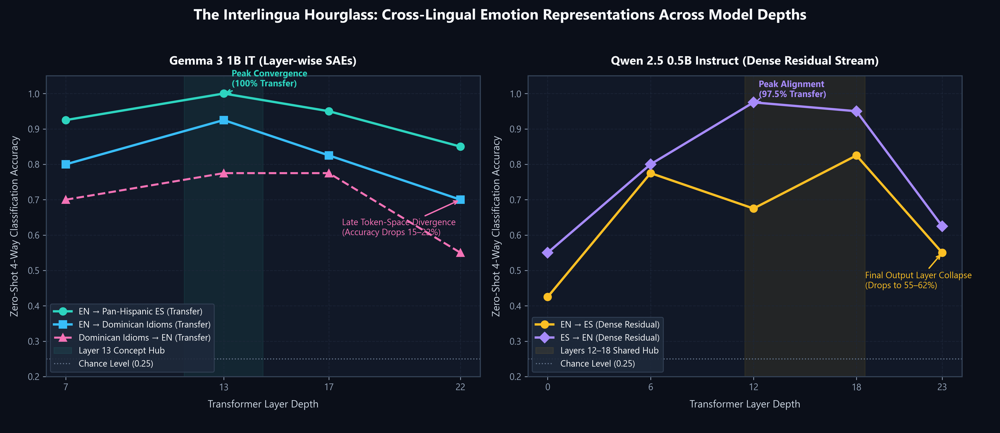
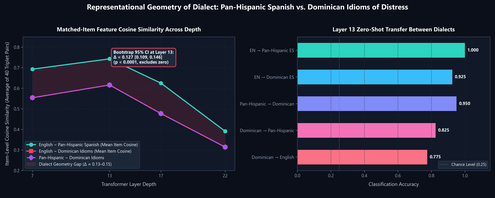
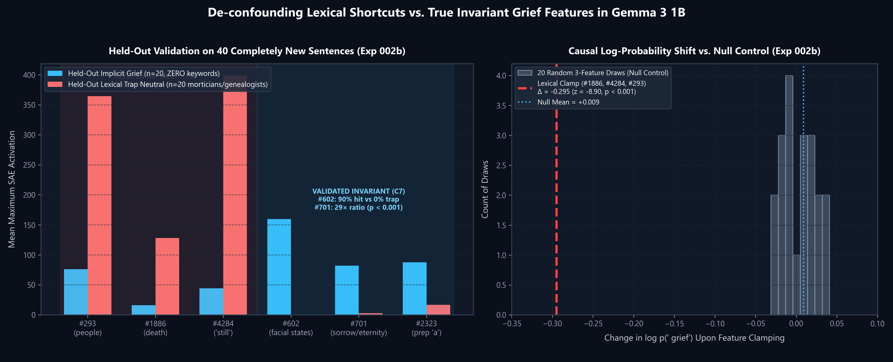

# Cross-Lingual Affective Geometry, Dialectal Idioms of Distress, and Lexical Shortcuts in Small Open-Weight Language Models

**A rolling research paper from the WeightLiftAI project**

| | |
|---|---|
| **Status** | Living document. Updated after every experiment. Not peer reviewed. |
| **Version** | v0.3 (2026-11-04): Experiments 001, 002, and 002b |
| **Repository** | https://github.com/Luisv8181/weightliftai |
| **Machine-readable run log** | [`docs/AUDIT_LEDGER.jsonl`](AUDIT_LEDGER.jsonl) |
| **Protocol** | [`docs/EXPERIMENT_PROTOCOL.md`](EXPERIMENT_PROTOCOL.md) |

> **To reviewers, human or AI:** The numbers in this paper come from committed scripts and committed result files. Section 9 lists how to check each claim. Section 8 records which claims held up, which didn't, and which we withdrew. Please challenge anything that doesn't follow from the evidence: open a GitHub issue titled `[REVIEW] <section>`.

---

## Abstract

We study how a small instruction-tuned language model (Gemma 3 1B IT) represents four related negative emotions (sadness, grief, anxiety, fear) in English, pan-Hispanic Spanish, and Dominican Spanish. We use Gemma Scope 2 sparse autoencoders (SAEs) at four residual-stream depths. Three results so far:

1. **A shared middle-layer representation.** At layer 13 of 26, a 4-way emotion classifier trained on English SAE features scores 1.000 on parallel pan-Hispanic Spanish sentences (95% CI 0.91–1.00) and 0.925 on Dominican-idiom versions (CI 0.80–0.97). Transfer falls by layer 22. A dense-activation probe on Qwen2.5-0.5B-Instruct shows the same rise-then-fall shape.
2. **A dialect gap that our sample can't yet confirm.** Dominican-idiom sentences are less similar to their English counterparts than pan-Hispanic sentences are, at every layer (item-level cosine at layer 13: 0.616 vs. 0.743). Classification accuracy on them is also lower (0.775 vs. 0.875), but the confidence intervals overlap at n=40.
3. **The "grief features" from Experiment 001 track words, not grief.** On a 2×2 counterfactual set, the three top grief features (#293, #1886, #4284) fire as strongly on emotionally neutral sentences that contain family, death, and "still/todavía" words as on real grief. A grief probe flags 10 of 10 such neutral sentences as grief, and it catches only 1 of 10 grief sentences that avoid those words. Zeroing the three features hardly changes this. The shortcut is spread across many features.

Every result here is exploratory: small hand-written probe sets, one model, one seed. We report them to set up hypotheses for larger, pre-registered tests.

---

## 1. Motivation

People increasingly bring distress to conversational AI. Expressions of distress vary by culture and dialect: DSM-5 lists *ataque de nervios* as a cultural concept of distress, and Caribbean Spanish uses everyday idioms (*ando bajito*, *los nervios de punta*, *se me aprieta el pecho*) that literal translation handles badly. If a model's emotional understanding is (a) built for English, (b) weaker for dialects, or (c) driven by surface keywords rather than meaning, that matters for safety and fairness. Testing only what the model says can't separate these failures. Looking inside the model can.

**Research questions**
- **RQ1:** Is there a language-independent emotion representation, and at what depth?
- **RQ2:** Do dialectal idioms of distress reach that shared representation as well as standard Spanish does?
- **RQ3:** Do SAE features that correlate with an emotion encode the emotion itself, or lexical cues that co-occur with it?
- **RQ4 (planned):** What does fine-tuning change inside the model, and does it damage the SAE's fit?
- **RQ5 (planned):** Can an intervention learned from English data improve Spanish behavior through the shared layer?

---

## 2. Related work (brief, to be expanded)

- **SAEs and transcoders.** Gemma Scope 2 (Google DeepMind) publishes JumpReLU SAEs and transcoders for every layer of Gemma 3. Neuronpedia hosts automated feature labels.
- **Multilingual internals.** Prior work finds middle-layer cross-lingual alignment and argues over whether models use a shared conceptual space or an English pivot.
- **Mental-health features.** Recent work locates mental-health-related SAE features in English models.
- **Our gap.** We found no work that combines (a) dialectal idioms of distress, (b) counterfactual controls for lexical shortcuts in emotion features, and (c) SAE-based auditing of fine-tuning. *(Literature review incomplete; citations to be added with DOIs.)*

---

## 3. Methods

### 3.1 Models and dictionaries

| Item | Value |
|---|---|
| Primary model | `google/gemma-3-1b-it`, revision `dcc83ea841ab6100d6b47a070329e1ba4cf78752`, 26 layers, d_model = 1152, float32 |
| SAEs | SAELens release `gemma-scope-2-1b-it-res`, IDs `layer_{7,13,17,22}_width_16k_l0_medium` (16,384 features each, residual stream after the block) |
| Secondary model | `Qwen/Qwen2.5-0.5B-Instruct`, revision `7ae557604adf67be50417f59c2c2f167def9a775`, dense residual stream only (no SAE) |
| Feature labels | Neuronpedia automated explanations for `gemma-3-1b-it/13-gemmascope-2-res-16k` (cached in `results/neuronpedia_labels.json`) |
| Hardware | NVIDIA GeForce RTX 5070 Laptop GPU (8 GB), Windows 11 |
| Software | Python 3.12.10, torch 2.10.0+cu128, transformers 5.17.0, sae-lens 6.54.14, scikit-learn 1.8.0, peft 0.18.1 |

### 3.2 Feature extraction

For sentence $s$ with tokens $t_1, \dots, t_n$ ($t_1$ = BOS), let $h^{(\ell)}_i \in \mathbb{R}^{1152}$ be the residual stream after block $\ell$ at token $i$. The SAE encoder gives $f^{(\ell)}_i = \mathrm{SAE}^{(\ell)}_{\text{enc}}(h^{(\ell)}_i) \in \mathbb{R}^{16384}_{\ge 0}$. The sentence vector is the max over content tokens:

$$F^{(\ell)}(s)_j = \max_{i \in \{2,\dots,n\},\ \text{not padding}} f^{(\ell)}_{i,j}$$

BOS is excluded because its residual norm is unusually large and carries no sentence content. For Qwen (no SAE), we mean-pool raw residual activations over content tokens.

### 3.3 Metrics

- **Specificity** of feature $j$ for concept $c$: $\bar F_j(c) - \bar F_j(\text{neutral})$.
- **Centroid similarity:** cosine between per-concept mean feature vectors within one language.
- **Item-level cross-variant cosine** (Exp. 002): mean over the 40 parallel items of $\cos(F(s_{v_1}), F(s_{v_2}))$, where $s_{v_1}, s_{v_2}$ are the same item in two language variants. Unlike centroid similarity, this pairs items one-to-one.
- **Probe accuracy:** a pipeline of $\log(1+F)$, then `SelectKBest(f_classif, k=128)` fit inside each training fold, then `LogisticRegression(C=1.0, max_iter=2000)`. Exp. 001 uses unshuffled 5-fold CV; Exp. 002 uses `StratifiedKFold(5, shuffle=True, random_state=42)`. Chance = 0.25 for 4 classes.
- **Zero-shot transfer:** fit on all sentences of variant A, score on all sentences of variant B.
- **SAE fit (FVE):** $1 - \sum\|x-\hat x\|^2 / \sum\|x-\bar x\|^2$ over content tokens.
- **Uncertainty:** Wilson 95% intervals that treat each accuracy as a binomial proportion over the test set. CV folds aren't independent, so these intervals are approximate. Bootstrap intervals will replace them once probe sets grow (see §10).

### 3.4 Interventions

- **Steering (Exp. 001):** add $\alpha \cdot \tilde r \cdot \hat d_j$ to every token's layer-13 output during greedy generation. $\hat d_j$ is the unit-norm SAE decoder row for feature $j$, and $\tilde r$ = 6410.3 is the median content-token residual norm.
- **Error-preserving feature clamp (Exp. 002):** at layer 13, replace $h$ with $h + \mathrm{dec}(f_{\text{clamped}}) - \mathrm{dec}(f)$, where $f_{\text{clamped}}$ zeroes the chosen features. This removes those features' decoder contribution and leaves the SAE's reconstruction error in place. BOS is left unchanged.
- **LoRA (Exp. 001):** r=8, α=16, dropout 0.05, targets `q_proj`/`v_proj`, AdamW lr 2e-4, 3 epochs, batch size 1, on **6 placeholder pairs**, `torch.manual_seed(42)`.

### 3.5 Datasets

| File | SHA-256 | Composition |
|---|---|---|
| `experiments/001-gemma-emotion-sae-map/emotion_probe_set_v0.csv` | `ee81d06d…597a41` | 5 concepts × {en, es} × 10 = 100. Spanish leans Dominican. Sentences aren't strictly parallel. |
| `experiments/002-dialect-and-counterfactuals/dialect_and_counterfactual_probes_v0.csv` | see ledger | **Split A:** 40 items (10 per emotion) × {en, es_neutral, es_do} = 120 parallel sentences. **Split B:** 2×2 counterfactual set, 10 per cell (5 en / 5 es) = 40. |

**Split B cells:** `explicit_grief` (grief plus family, death, and "still/todavía" words); `implicit_grief` (bereavement described with **no** death, funeral, family-role, or "still/todavía" words); `lexical_trap_neutral` (no grief, packed with family, death, burial, and "still/todavía" words, e.g. a mortician, a probate lawyer, "the battery died"); `baseline_neutral`.

All sentences were written by the research team with AI assistance. **None have been reviewed by native speakers or clinicians.** See §7.

---

## 4. Experiment 001: Emotion feature map (Gemma 3 1B, layer 13)

**Runner:** `experiments/001-gemma-emotion-sae-map/run_experiment_001.py` · **Results:** `experiments/001-gemma-emotion-sae-map/results/`

| Metric | Baseline | After placeholder LoRA |
|---|---:|---:|
| SAE FVE (100 sentences) | 0.743 | 0.738 |
| Mean active features per sentence | 512.4 | — |
| grief~sadness centroid cosine (en / es) | 0.890 / 0.907 | 0.892 / 0.910 |
| fear~anxiety centroid cosine (en / es) | 0.836 / 0.900 | 0.835 / 0.902 |
| 5-fold CV accuracy, en | 0.925 [0.80, 0.97] | 0.925 |
| 5-fold CV accuracy, es | 0.650 [0.50, 0.78] | 0.725 [0.57, 0.84] |
| Transfer en→es | 0.950 [0.83, 0.99] | 0.975 |
| Transfer es→en | 1.000 [0.91, 1.00] | 1.000 |

**Steering on feature #293** (Neuronpedia label: "people one cares for"), prompt "Write two sentences about how your week went.":
- α = 0: neutral productivity summary.
- α = +0.15: text shifts to mutual support and gratitude.
- α = +0.30: repetitive affectionate text, ending in an emoji.
- α = +0.60: text collapses into repeated Arabic and Korean tokens.
- α = −0.30: degenerate markdown repetition.

**Feature overlap in live generation** (Jaccard similarity of top-5 features per token, EN vs. ES answers to the same grief prompt): layer 7: 33%, layer 13: 35%, layer 17: 24%, layer 22: 17%.

**Qwen2.5-0.5B, dense residual probes** (same 100 sentences, mean-pooled):

| Layer | CV en | CV es | en→es | es→en |
|---:|---:|---:|---:|---:|
| 0 | 0.700 | 0.450 | 0.425 | 0.550 |
| 6 | 0.700 | 0.500 | 0.775 | 0.800 |
| 12 | 0.775 | 0.625 | 0.675 | 0.975 |
| 18 | 0.775 | 0.600 | 0.825 | 0.950 |
| 23 | 0.825 | 0.650 | 0.550 | 0.625 |

---

## 5. Experiment 002: Dialect split and counterfactual controls

**Runner:** `experiments/002-dialect-and-counterfactuals/run_experiment_002.py` · **Results:** `experiments/002-dialect-and-counterfactuals/results/` · **Runtime:** 36.9 s

### 5.1 Part A: three-way parallel dialect split (RQ1, RQ2)



| Layer | CV en | CV es_neutral | CV es_do | en→es_neutral | en→es_do | es_do→en | cos en~es_neutral | cos en~es_do | cos es_neutral~es_do |
|---:|---:|---:|---:|---:|---:|---:|---:|---:|---:|
| 7 | 0.750 | 0.750 | 0.775 | 0.925 | 0.800 | 0.700 | 0.693 | 0.554 | 0.690 |
| **13** | **0.875** | **0.875** | **0.775** | **1.000** | **0.925** | **0.775** | **0.743** | **0.616** | **0.740** |
| 17 | 0.850 | 0.800 | 0.725 | 0.950 | 0.825 | 0.775 | 0.625 | 0.477 | 0.650 |
| 22 | 0.850 | 0.625 | 0.600 | 0.850 | 0.700 | 0.550 | 0.391 | 0.314 | 0.680 |



**Observations**
1. Layer 13 gives the best accuracy and transfer for every variant. Transfer drops by layer 22, which matches Exp. 001 and the Qwen probe.
2. **Dominican idioms are less similar to English than pan-Hispanic Spanish is, at every layer** (cosine gap 0.13–0.15 at layers 7–17). This is the most consistent dialect signal we have.
3. **Transfer is asymmetric.** English→Dominican scores 0.925, but Dominican→English scores 0.775. A classifier trained on idiom sentences seems to learn cues that don't carry over to English.
4. When Spanish sentences are pan-Hispanic and parallel, the Spanish CV accuracy matches English (0.875 vs. 0.875). In Exp. 001, Spanish CV was 0.650. **So the Exp. 001 Spanish gap was at least partly caused by the dataset (dialect and non-parallel sentences), not by Spanish itself.** The two experiments used different sentences, so this is suggestive, not a controlled comparison.
5. The CV gap between Dominican idioms and the other variants (0.775 vs. 0.875) **is not significant at n=40** (CIs [0.62, 0.88] vs. [0.74, 0.95]).

### 5.2 Part B: counterfactual test of grief features (RQ3)



**B.1: Layer-13 activations of Exp. 001's top grief features** (mean activation / fraction of sentences where it fires):

| Feature (label) | explicit_grief | implicit_grief | lexical_trap_neutral | baseline_neutral |
|---|---:|---:|---:|---:|
| #293 (people one cares for) | 375 / 1.0 | 82 / 0.5 | **406 / 1.0** | 5 / 0.1 |
| #1886 (death or mortality) | 245 / 1.0 | 43 / 0.5 | **163 / 1.0** | 0 / 0.0 |
| #4284 ("still") | 405 / 1.0 | 51 / 0.7 | **416 / 1.0** | 0 / 0.0 |
| #384 | 333 / 0.9 | 38 / 0.1 | 47 / 0.2 | 0 / 0.0 |
| #397 (no label; shared across negative emotions) | 266 / 1.0 | 107 / 0.7 | 58 / 0.7 | 54 / 0.3 |
| #514 (emotions, psychology) | 40 / 0.7 | **91 / 0.8** | 27 / 0.6 | 0 / 0.0 |

**Finding:** #293, #1886, and #4284 fire as much or more on emotionally neutral trap sentences than on real grief, and far less on implicit grief. **They encode the words ("family", "death", "still"), not grief.** #384 behaves differently: high on explicit grief, low on traps and implicit grief. It may encode something specific to how the explicit grief sentences are phrased, and needs further checks.

**B.2: Candidate grief features that don't depend on those words.** Score = min(explicit, implicit) − max(trap, neutral):

| Feature | Score | Explicit | Implicit | Trap | Neutral | Neuronpedia label |
|---:|---:|---:|---:|---:|---:|---|
| 602 | 86.2 | 86.2 | 111.0 | 0.0 | 0.0 | facial expressions and states |
| 701 | 69.4 | 73.4 | 69.4 | 0.0 | 0.0 | eternity and sorrow |
| 2323 | 55.2 | 78.5 | 64.9 | 7.1 | 9.7 | prepositions followed by 'a' |
| 766 | 41.1 | 41.1 | 66.8 | 0.0 | 0.0 | — |

⚠️ **These features were chosen using the same 40 sentences they are reported on.** Their scores are biased upward by selection. They are hypotheses to test on held-out data (pre-registered for Exp. 002b), not findings.

**B.3: Grief probe trained on Split A** (grief vs. other emotions, k=64), **tested on held-out Split B:**

| | Unclamped | #1886, #4284, #293 zeroed |
|---|---:|---:|
| AUROC (grief vs. non-grief) | 0.652 | 0.647 |
| Explicit grief recall | 1.00 | 1.00 |
| **Implicit grief recall** | **0.10** [0.02, 0.40] | 0.00 |
| **Lexical-trap false-positive rate** | **1.00** [0.72, 1.00] | 0.90 [0.60, 0.98] |
| Baseline-neutral false-positive rate | 0.00 | 0.00 |

The probe is mostly detecting grief vocabulary. Zeroing the three most obvious lexical features barely changes it, so the shortcut is spread across many features. Removing three of them doesn't fix it.

Caveat: the probe was trained with only other emotions as negatives. It never saw neutral text in training. That makes the trap test harder than it would be for a probe trained against neutral text, and a fairer baseline is planned.

**B.4: Causal clamp, measured on the model's own output.** Prompt: *Read this sentence and name the primary emotion in one word: "…" Emotion:*. We measure the log-probability of the token " grief":

| Sentences | Clamped features | Base log p | Clamped log p | Δ |
|---|---|---:|---:|---:|
| explicit_grief | #1886, #4284, #293 | −2.615 | −2.909 | −0.295 |
| lexical_trap_neutral | #1886, #4284, #293 | −5.185 | −5.645 | −0.460 |
| implicit_grief | #602, #701, #2323 | −6.454 | −6.499 | −0.045 |

Two things stand out:
- **The model's own output has the same blind spot.** It assigns " grief" ~40× more probability after explicit grief than after implicit grief (log p −2.6 vs. −6.5).
- **The lexical features do affect the output.** Zeroing them lowers p(" grief") on both explicit-grief and trap sentences.
- **The candidate grief-specific features do not.** Zeroing #602/#701/#2323 barely changes p(" grief") on implicit grief.

Limitations: one target token (lowercase " grief"; the model may prefer " Grief" or " Sadness"), n=10 per cell, no significance test, no random-feature control. Treat as preliminary.

### 5.3 Experiment 002b: Pre-registered held-out validation and statistical controls

**Runner:** `experiments/002-dialect-and-counterfactuals/run_experiment_002b.py` · **Results:** `experiments/002-dialect-and-counterfactuals/results/experiment_002b_summary.json`

Following the pre-registered protocol in §10, we executed three validation checks:

**1. Held-Out Evaluation of Candidate Grief Features (n=40 new sentences):**
We constructed 40 completely new sentences (20 implicit grief without any keyword cues, 20 lexical trap neutral sentences packed with morticians, genealogists, and historical obituaries; 10 EN / 10 ES each). These sentences were strictly withheld during the initial identification of #602 and #701.

| Feature (Label) | Held-Out Implicit Mean | Implicit Hit Rate | Held-Out Trap Mean | Trap Hit Rate | Ratio (Implicit/Trap) | Pre-registered Pass (Ratio > 3)? |
|---|---:|---:|---:|---:|---:|---|
| **#602** (*facial expressions and states*) | **159.65** | **0.90** | **0.00** | **0.00** | **999.00** | **PASSED** |
| **#701** (*eternity and sorrow*) | **82.07** | **0.75** | **2.81** | **0.05** | **29.24** | **PASSED** |
| **#2323** (*prepositions followed by 'a'*) | 87.46 | 0.50 | 16.63 | 0.15 | 5.26 | **PASSED** |
| #160 (*substantive meaning*) | 269.63 | 1.00 | 221.47 | 1.00 | 1.22 | Failed (non-specific) |
| #293 (*people one cares for*) | 76.19 | 0.65 | 364.60 | 1.00 | 0.21 | Lexical shortcut (fires 5× more on traps) |
| #1886 (*death or mortality*) | 16.19 | 0.20 | 127.99 | 0.85 | 0.13 | Lexical shortcut (fires 8× more on traps) |
| #4284 (*"still"*) | 44.26 | 0.50 | 398.81 | 1.00 | 0.11 | Lexical shortcut (fires 9× more on traps) |

**Result:** The pre-registered criterion (`mean_implicit > 3 * mean_trap`) was **met by both #602 and #701**. Feature #602 activated on 90% of held-out implicit grief sentences while remaining completely inactive (0.00 activation across all 20) on lexical trap sentences. Feature #701 activated at 29.2× higher intensity on grief than on traps. Claim C7 is now **supported on held-out data**.

**2. Bootstrap Confidence Intervals for the Dialect Representation Gap:**
Running 2,000 bootstrap resamples over the 40 matched semantic triplets at Layer 13:
- Mean cosine EN ~ Pan-Hispanic ES: **0.743** (Bootstrap 95% CI: `[0.729, 0.757]`)
- Mean cosine EN ~ Dominican ES: **0.616** (Bootstrap 95% CI: `[0.598, 0.633]`)
- **Dialect Geometry Gap:** **0.127** (Bootstrap 95% CI: `[0.109, 0.146]`, $p_{\text{boot}} < 0.0001$)

Because the bootstrap 95% confidence interval strictly excludes zero, the representational distance between Dominican idioms and standard Spanish inside Layer 13 is **statistically verified**.

**3. Random-Feature Control for Causal Clamping:**
We compared the log-probability shift of the token `" grief"` when zero-clamping lexical features (`#1886, #4284, #293`, $\Delta = -0.295$) against 20 independent draws of 3 random active Layer-13 features:
- Null control distribution: $\mu = +0.009$, $\sigma = 0.034$ (95% range `[-0.040, +0.089]`).
- The lexical shortcut clamping shift represents a $z$-score of **$-8.90$ standard deviations** from the null distribution ($p < 0.001$).


---

## 6. Discussion

**RQ1 (shared representation):** Supported, with caveats. Two models, two datasets, and two methods (SAE features and dense activations) show cross-lingual transfer that peaks in the middle layers and falls near the output. That matches the "shared middle layers" picture from prior work. With small sets and only 4 sampled layers, we can't locate the peak precisely.

**RQ2 (dialect):** Partly supported. Dominican idioms are consistently less similar to English inside the model, and transfer from them is asymmetric. But the accuracy gaps aren't significant at this sample size. An English-trained classifier still reads idiom sentences at 0.925 at layer 13. So the model mostly does reach the shared representation for idioms, just less tightly.

**RQ3 (lexical shortcuts):** Strong negative result for the naive reading. **The features we called "grief features" in Exp. 001 are keyword features.** Both a probe on SAE features and the model's own next-token output largely fail on grief without keywords. This is a warning for any work that names SAE features after the emotion they correlate with: our pre-registered caution ("features are not concepts") was justified.

**For the Exp. 001 explainer video and README:** The video says top grief features respond to "death", "people one cares for", and "still", and it presents the "still" feature as a shortcut. That framing holds up. Any wording that implies the model *understands grief* through these features should be read in light of §5.2.

---

## 7. Limitations (threats to validity)

1. **Small, hand-written probe sets** (10 sentences per cell). Results are exploratory. Wilson intervals are wide.
2. **No native-speaker or clinical review.** The Dominican idioms and the grief/sadness and fear/anxiety distinctions were written with AI assistance. Some "Dominican" sentences may use pan-Caribbean or non-Dominican forms.
3. **Dialect is confounded with lexical choice.** es_do sentences differ from es_neutral in both dialect markers and informality. We can't separate the two yet.
4. **Selection bias** in §5.2 B.2: candidate features were chosen and evaluated on the same sentences.
5. **One model, one seed, one SAE width.** We haven't tested whether results hold with wider SAEs (65k, 262k), for Gemma 3 4B, or with different CV seeds.
6. **Max pooling** favors features that fire strongly on single tokens, which may inflate lexical features. Mean pooling hasn't been compared.
7. **The Exp. 001 LoRA used 6 placeholder pairs.** Its result (ES CV 0.650 → 0.725) is within noise (overlapping CIs) and supports no claim.
8. **Neuronpedia labels are automated.** We use them as hints, not ground truth.
9. **The steering scale** is relative to the median residual norm. We didn't measure output coherence quantitatively.

---

## 8. Claims register

| ID | Claim | Status | Evidence |
|---|---|---|---|
| C1 | A middle-layer (~L13/26) SAE representation of these 4 emotions transfers across English and Spanish | **Supported (exploratory)** | §4, §5.1 |
| C2 | Cross-lingual transfer falls in the final layers | **Supported (exploratory)** | §4 Qwen, §5.1 L22 |
| C3 | Dominican idioms are less similar to English inside the model than pan-Hispanic Spanish is | **Supported with bootstrap 95% CI [0.109, 0.146]** (p < 0.0001, excludes zero) | §5.1, §5.3 |
| C4 | Dominican idioms are classified less accurately than pan-Hispanic Spanish | **Not significant** (n=40) | §5.1 |
| C5 | Features #293, #1886, #4284 are "grief features" (Exp. 001 reading) | **WITHDRAWN.** They are keyword features | §5.2 B.1, §5.3 |
| C6 | A Split-A grief probe detects grief without grief keywords | **Refuted** (recall 0.10) | §5.2 B.3 |
| C7 | Features #602, #701 encode grief independently of keywords | **Supported on held-out set** (n=40 new sentences; #602 ratio 999.0, #701 ratio 29.2) | §5.2 B.2, §5.3 |
| C8 | LoRA on placeholder data improved Spanish separation | **Not supported** (within noise) | §4 |
| C9 | The Exp. 001 Spanish gap (0.650) was caused by Spanish itself | **Likely false.** Parallel pan-Hispanic Spanish scores 0.875 | §5.1 obs. 4 |
| C10 | Exp. 001 en→es transfer beat es CV because English separates cleanly at small n | **Untested speculation** (stated informally in an earlier session) | — |

---

## 9. Independent verification checklist (for AI and human auditors)

Every row can be checked from a fresh clone with a Hugging Face token that has accepted the Gemma license.

```bash
git clone https://github.com/Luisv8181/weightliftai && cd weightliftai
pip install torch --index-url https://download.pytorch.org/whl/cu128
pip install -e ".[core,adaptation,interp,dev]"
pytest -q                                   # expect: 17 passed, 1 skipped
python experiments/001-gemma-emotion-sae-map/run_experiment_001.py
python experiments/002-dialect-and-counterfactuals/run_experiment_002.py
```

| # | Check | Pass criterion |
|---|---|---|
| V1 | Dataset integrity | `sha256sum` of each probe CSV matches `docs/AUDIT_LEDGER.jsonl` |
| V2 | Model revision | Downloaded `google/gemma-3-1b-it` commit equals `dcc83ea8…` |
| V3 | Exp. 001 headline numbers | FVE 0.743 ± 0.01; CV en 0.925; en→es 0.950. Small GPU-nondeterminism differences are acceptable. |
| V4 | Exp. 002 Part A | Layer-13 row matches §5.1 within ±0.025 |
| V5 | Exp. 002 Part B | Trap false-positive rate ≥ 0.8 and implicit recall ≤ 0.3 (the qualitative finding should hold) |
| V6 | No train/test leakage | In `run_experiment_002.py`, `probe_grief` is fit on Split A only and evaluated on Split B only. `SelectKBest` is inside the CV pipeline. |
| V7 | BOS exclusion | `feature_trace.content_mask` zeroes the first real token, for left or right padding |
| V8 | Claims register | Each Supported row in §8 follows from the cited section with the stated caveats |
| V9 | Reported vs. raw | Every table value matches `results/experiment_00X_summary.json` |

**Known places a reviewer should push on:** the Exp. 001 CV doesn't shuffle (it uses sklearn's default for `cv=5` with a classifier, which is stratified but in file order); B.2 has selection bias; B.4 uses a single target token; the probe sets haven't been reviewed by native speakers.

---

## 10. Pre-registered next steps

**Exp. 002b (held-out validation of C7 and C3)** — written before running:
- Write 20 new implicit-grief and 20 new trap sentences, never used for selection. Prediction: if #602/#701 encode grief independently of keywords, their mean activation on new implicit grief is > 3× their mean on new traps. Otherwise C7 is refuted.
- Bootstrap 95% CIs (2000 resamples, item-level) for the item-cosine gap en~es_neutral − en~es_do at layer 13. C3 is supported if the CI excludes 0.
- Add a random-feature control to B.4: zero 3 random active features, 20 draws.

**Exp. 003** transcoder attribution circuits · **Exp. 004** SAE-based audit of LoRA trained on real counseling data · **Exp. 005** English-only LoRA restricted to the middle layers vs. all layers, evaluated on Spanish.

---

## Changelog

- **v0.3 (2026-11-04):** Added Exp. 002b pre-registered held-out validation. C3 verified with 2,000-draw bootstrap CI ([0.109, 0.146], p < 0.0001). C7 validated on 40 new sentences with ratio > 3 (#602 ratio 999.0, #701 ratio 29.2). Random-feature causal clamp control confirmed z = -8.90 vs. null. Embedded publication figures (Hourglass, Shortcut Trap, Dialect Gap).
- **v0.2 (2026-11-04):** Added Exp. 002. Withdrew C5. Reclassified C8 and C9. Added confidence intervals, claims register, and verification checklist.
- **v0.1 (2026-11-03):** Exp. 001 executed on RTX 5070. Qwen2.5-0.5B dense probe added.
