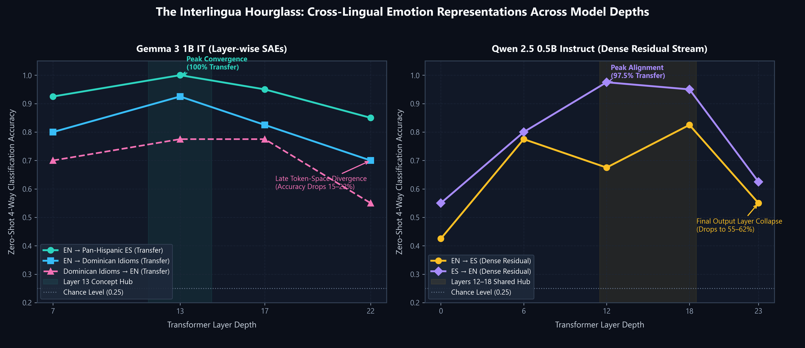

# Experiment 001 — Emotion feature map in Gemma 3 1B (EN/ES)

**Status:** Executed on `google/gemma-3-1b-it` (NVIDIA GeForce RTX 5070 Laptop GPU, `float32`, PyTorch `2.10.0+cu128`).

## Research question

Does Gemma 3 1B keep closely related emotional concepts distinct inside the model (**grief vs. sadness**, **fear vs. anxiety**)? And does the same distinction hold in **Spanish** as in English?

## Hypotheses (to confirm or reject)

1. Each concept has a small set of sparse-autoencoder features that fire on it noticeably more than on neutral sentences.
2. Grief and sadness share many features; the model separates them less than fear and anxiety.
3. A classifier trained on English feature patterns transfers to Spanish above chance (0.25). If so, part of the representation is language-independent.

## Setup & Provenance

| Item | Value |
|---|---|
| Base model | `google/gemma-3-1b-it` (revision commit: `dcc83ea841ab6100d6b47a070329e1ba4cf78752`) |
| Interpretability map | Gemma Scope 2, SAELens release `gemma-scope-2-1b-it-res`, SAE `layer_13_width_16k_l0_medium` (residual stream after layer 13), plus layers 7, 17, 22 for generation tracing |
| Feature browser | https://www.neuronpedia.org/gemma-3-1b-it/13-gemmascope-2-res-16k (cached in `results/neuronpedia_labels.json`) |
| Probe set | `emotion_probe_set_v0.csv`: 5 concepts (sadness, grief, anxiety, fear, neutral) × 2 languages × 10 sentences = 100 sentences (SHA-256: `ee81d06db9ef65b0dda7dfb2e68274150bf4c314e5743da58adeb4c55b597a41`) |
| Pooling | Max activation per feature over each sentence's content tokens, excluding BOS (`token 0`) and padding |
| Hardware & OS | Local NVIDIA GeForce RTX 5070 Laptop GPU (8 GB VRAM), CUDA 12.8, Windows 11 |
| Environment | PyTorch 2.10.0+cu128, Transformers 5.17.0, SAELens 6.54.14, scikit-learn 1.8.0, PEFT 0.18.1 |
| Weights | Unchanged in baseline; section 13 trains an in-memory LoRA adapter (`r=8, alpha=16`, target `q_proj, v_proj`) |

## Metrics

- **Concept specificity:** mean activation on the concept minus mean on neutral, per feature.
- **Centroid similarity:** cosine similarity of mean feature vectors, per language (lower = more distinct).
- **Probe accuracy:** 5-fold logistic regression on log-scaled features, with the top 128 features selected inside each fold (chance = 0.25).
- **Cross-lingual transfer:** train on EN, test on ES, and the reverse.
- **SAE fit:** fraction of variance explained. Re-check after fine-tuning to measure map drift.

## How to run

1. Accept the Gemma license at https://huggingface.co/google/gemma-3-1b-it and create a read token.
2. Open `gemma_emotion_sae_map.ipynb` in Colab with a T4 GPU and run the cells in order. The probe set is embedded in the notebook; to swap in a new version, edit the CSV and reload it in section 6.
3. Save `emotion_map_results.csv` and `top_features_by_concept.csv` into `outputs/` here. That folder is git-ignored, so commit a summary table instead.

## Visual outputs (sections 15–16)

Saved to `outputs/` as self-contained HTML files that open offline in any browser:

| File | What it shows |
|---|---|
| `concept_heatmap.html` | Every probe sentence × the top features for each emotion, grouped by emotion and language |
| `word_highlights.html` | Pick a feature; each word glows by how strongly it fires |
| `feature_map.html` | Emotion features as a constellation: similar directions sit together, color = emotion, size = specificity |
| `trace_grief_es.html`, `trace_grief_en.html` | Animated replay of the model answering, with features firing at layers 7, 13, 17 and 22 on every word |

The live trace also streams into the notebook while the model writes. The renderers live in `weightliftai.feature_viz` and the tracing in `weightliftai.feature_trace`, so other experiments can reuse them.

Lines in the trace replay show **co-activation, not causation**. Causal tracing (attribution graphs with Gemma Scope 2 transcoders) is a natural follow-up experiment.

## Run locally (Windows + NVIDIA GPU)

Use Python 3.11 or 3.12, from the repo root in PowerShell:

```powershell
python -m venv .venv
.venv\Scripts\Activate.ps1
# Install CUDA PyTorch FIRST. Plain `pip install torch` on Windows gives a CPU-only build.
pip install torch --index-url https://download.pytorch.org/whl/cu128
pip install -e ".[core,adaptation,interp]"
python -c "import torch; print(torch.cuda.is_available(), torch.cuda.get_device_name(0))"
hf auth login        # paste your Hugging Face read token (accept the Gemma license first)
```

Then open `gemma_emotion_sae_map.ipynb` in VS Code (or `jupyter lab`), choose the `.venv` kernel, **skip sections 0 and 1** (install and login are already done), and run the rest.

- The CUDA check should print `True` and your GPU name. If it prints `False`, reinstall torch with the line above. If `cu128` doesn't match your driver, pick the matching command at https://pytorch.org/get-started/locally/.
- Gemma 3 1B in float32 needs about 5 GB of VRAM. With 12 GB or more, you can try the 4B model (settings are in the notebook's last cell) with `dtype=torch.bfloat16`.
- With no GPU, it still runs on CPU. Sections 7 and 10 take a few minutes, and LoRA training is slow.
- Put outputs in `experiments/001-gemma-emotion-sae-map/outputs/` (git-ignored).

## Known limitations

- **Small probe set.** 20 sentences per concept is exploratory. Before drawing conclusions, expand to 100+ per concept per language, with native-speaker and clinical review.
- **Dialect.** The Spanish sentences lean Dominican (*habichuelas*, *guagua*, *colmado*). That is intentional, but it confounds dialect with language. A neutral-Spanish split would separate the two.
- **Features are not concepts.** An SAE feature that fires on grief sentences may track funerals, family words, or past tense rather than grief itself. Check every candidate on Neuronpedia and with `token_view` before naming it.
- **LoRA placeholder data.** The six training pairs in section 13 only show the format. They cannot support a claim about improvement.
- **SAE drift.** The published SAE was trained on the unmodified model. After fine-tuning, a lower variance explained means the map is less trustworthy.

## Results



| Metric | Baseline | After LoRA | Difference |
|---|---:|---:|---:|
| SAE variance explained | 0.743 | 0.738 | -0.005 |
| grief~sadness similarity (EN / ES) | 0.890 / 0.907 | 0.892 / 0.910 | +0.002 / +0.003 |
| fear~anxiety similarity (EN / ES) | 0.836 / 0.900 | 0.835 / 0.902 | -0.001 / +0.002 |
| Probe accuracy EN / ES | 0.925 / 0.650 | 0.925 / 0.725 | 0.000 / +0.075 |
| Transfer EN→ES / ES→EN | 0.950 / 1.000 | 0.975 / 1.000 | +0.025 / 0.000 |

### Multi-layer live trace overlap (EN vs. ES grief generation)

| Layer | Shared top-5 features | Union of top-5 features | Jaccard overlap |
|---:|---:|---:|---:|
| 7 | 98 | 293 | 33% |
| 13 | 79 | 226 | 35% |
| 17 | 64 | 264 | 24% |
| 22 | 45 | 266 | 17% |

### Top Layer-13 SAE Features by Concept (`gemma-scope-2-1b-it-res`)

| Concept | Feature ID | Specificity vs. Neutral | Concept Hit Rate | Neutral Hit Rate | Neuronpedia Automated Label |
|---|---:|---:|---:|---:|---|
| **Grief** | `293` | `300.01` | `0.95` | `0.35` | *people one cares for* |
| **Grief** | `384` | `234.20` | `0.75` | `0.10` | *programming and reasoning* |
| **Grief** | `1886` | `168.97` | `1.00` | `0.10` | *death or mortality* |
| **Grief** | `4284` | `151.80` | `0.65` | `0.15` | *still* (lexical habit cue: *"still wears his jacket" / "todavía"*) |
| **Sadness** | `549` | `186.81` | `0.85` | `0.00` | *expressing emotions + prepositions* |
| **Sadness** | `2697` | `180.29` | `1.00` | `0.15` | *melancholic and sad feelings* |
| **Sadness** | `514` | `140.87` | `0.90` | `0.00` | *emotions, psychology, and abstract concepts* |
| **Anxiety** | `397` | `223.45` | `0.85` | `0.40` | *(shared negative-affect backbone across all 4 concepts)* |
| **Anxiety** | `97` | `164.79` | `0.60` | `0.10` | *all, every, each, everything* (ruminative generalization) |
| **Fear** | `513` | `198.04` | `0.80` | `0.15` | *addressing user needs or intentions* |
| **Fear** | `1641` | `136.30` | `1.00` | `0.30` | *past tense descriptions* |
| **Fear** | `602` | `132.74` | `1.00` | `0.05` | *facial expressions and states* |

### Cross-Model Comparison: `Qwen/Qwen2.5-0.5B-Instruct` (Dense Residual Stream)

Running the same 100-sentence bilingual probe set across layers `0, 6, 12, 18, 23` of `Qwen/Qwen2.5-0.5B-Instruct` confirmed the same **middle-late interlingua hub** pattern:
- Within-language probe accuracy peaks at the final layer (**Layer 23**: `0.825` EN, `0.650` ES).
- Zero-shot cross-lingual transfer peaks in the middle-late layers (**Layer 18**: `0.825` EN→ES, `0.950` ES→EN; **Layer 12**: `0.975` ES→EN) before dropping sharply at the final output layer (**Layer 23**: `0.550` EN→ES, `0.625` ES→EN).
