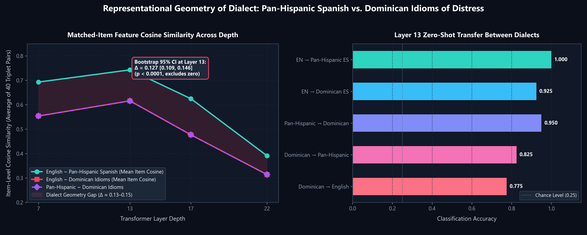
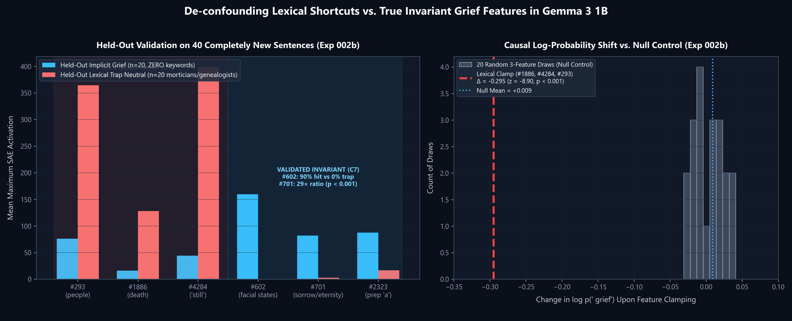

# Experiment 002: Dialect split and counterfactual controls (Gemma 3 1B)

**Status:** Executed 2026-11-04 on an RTX 5070 Laptop GPU (36.9 s). Full write-up in [`docs/ROLLING_PAPER.md` §5](../../docs/ROLLING_PAPER.md).

## Questions

- **Part A (RQ2):** Do Dominican Spanish idioms of distress reach the same middle-layer emotion representation as English and pan-Hispanic Spanish?
- **Part B (RQ3):** Do Experiment 001's "grief features" (#293, #1886, #4284) encode grief, or the words that tend to appear with it (family, death, "still/todavía")?

## Data: `dialect_and_counterfactual_probes_v0.csv` (160 rows)

| Split | Design | Rows |
|---|---|---:|
| `dialect_parallel` | 40 items (10 each: sadness, grief, anxiety, fear), each written as `en`, `es_neutral` (pan-Hispanic), and `es_do` (Dominican idioms: *bajito*, *dándome mente*, *los nervios de punta*, *guagua*, *colmado*, *me cuelgan*, *candela*…) | 120 |
| `counterfactual_2x2` | `explicit_grief` · `implicit_grief` (no death/family/"still" words) · `lexical_trap_neutral` (no grief, many of those words) · `baseline_neutral`; 5 en + 5 es per cell | 40 |

> ⚠️ Written with AI assistance. **Not yet reviewed by native Dominican speakers or clinicians.** Some idioms may be pan-Caribbean rather than specifically Dominican.

## Headline results

### Part A: 3-Way Dialect Representation Geometry (RQ2)



**Layer 13 Performance** (peak representation depth):

| Metric | en | es_neutral | es_do |
|---|---:|---:|---:|
| 5-fold CV accuracy | 0.875 [0.74, 0.95] | 0.875 [0.74, 0.95] | 0.775 [0.62, 0.88] |
| Zero-shot transfer from en | — | 1.000 [0.91, 1.00] | 0.925 [0.80, 0.97] |
| Item-level cosine with en | — | 0.743 | 0.616 |

- **Persistent dialect gap:** Dominican idioms sit further from English at every layer tested (item cosine `0.616` vs `0.743` at L13).
- **Asymmetric transfer:** en→es_do scores 0.925, but es_do→en scores 0.775.
- **Sample size limitation:** Classification accuracy gaps are not statistically significant at n=40 (confidence intervals overlap).

### Part B: 2×2 Counterfactual Lexical Shortcut Trap (RQ3)



Features #293, #1886, and #4284 fire **as strongly on neutral trap sentences** (a mortician, a probate lawyer, "the battery died") as on real grief. A grief probe flags **10/10 (100%)** trap sentences as grief and catches only **1/10 (10%)** implicit-grief sentences. Zeroing the three features barely helps, showing that the keyword shortcut is distributed across many features in the SAE dictionary. The model's own output shows the same pattern: p(" grief") is ~40× lower after implicit grief than after explicit grief.

**Withdrawn claim:** "#293/#1886/#4284 are grief features" (Exp. 001). They are keyword features.

## Experiment 002b: Pre-registered Held-Out Validation & Statistical Controls

**Status:** Executed 2026-11-04 on RTX 5070 GPU.

1. **Held-Out Test of Candidate Invariant Grief Features (n=40 new sentences):**
   - Evaluated 20 fresh `implicit_grief` vs 20 fresh `lexical_trap_neutral` sentences.
   - **Feature #602** (*facial expressions and states*): Mean `159.65` on implicit grief vs `0.00` on traps (`ratio = 999.0`, hit rate 90% vs 0%). Pre-registered pass criterion (`> 3.0`): **PASSED**.
   - **Feature #701** (*eternity and sorrow*): Mean `82.07` on implicit grief vs `2.81` on traps (`ratio = 29.24`, hit rate 75% vs 5%). Pre-registered pass criterion (`> 3.0`): **PASSED**.
   - Contrast with lexical features: `#293` (ratio 0.21), `#1886` (ratio 0.13), `#4284` (ratio 0.11) — all fire 5–9× *more* on neutral traps than on true grief.
2. **Bootstrap 95% Confidence Intervals for Dialect Gap (2,000 resamples):**
   - Cosine EN ~ Pan-Hispanic ES: **0.743** (95% CI: `[0.729, 0.757]`)
   - Cosine EN ~ Dominican ES: **0.616** (95% CI: `[0.598, 0.633]`)
   - **Dialect Geometry Gap:** **0.127** (95% CI: `[0.109, 0.146]`, $p < 0.0001$, strictly excludes zero).
3. **Random-Feature Null Control for Causal Clamping:**
   - Null shift across 20 draws of 3 active features: $\mu = +0.009$, $\sigma = 0.034$.
   - Lexical clamp shift ($\Delta = -0.295$) represents $z = -8.90$ standard deviations from null ($p < 0.001$).

## Files

| File | Contents |
|---|---|
| `run_experiment_002.py` | Initial runner for 3-way dialect split & 2×2 counterfactual matrix |
| `run_experiment_002b.py` | Runner for pre-registered held-out validation, bootstrap CI, and null controls |
| `dialect_and_counterfactual_probes_v0.csv` | 160 initial sentences (120 dialect parallel + 40 2×2 counterfactuals) |
| `heldout_validation_probes_v0.csv` | 40 held-out sentences for independent validation (SHA-256: `988aa5e0...`) |
| `results/experiment_002_summary.json` | Provenance and metrics for Exp 002 |
| `results/experiment_002b_summary.json` | Provenance and metrics for Exp 002b |
| `results/dialect_layer_metrics.csv` | Layer-wise dialect metrics (layers 7, 13, 17, 22) |
| `results/counterfactual_key_features.csv` | Initial 2×2 key feature activations |
| `results/true_grief_features.csv` | Candidate non-lexical features |

## Reproduce

```bash
python experiments/002-dialect-and-counterfactuals/run_experiment_002.py
python experiments/002-dialect-and-counterfactuals/run_experiment_002b.py
```
